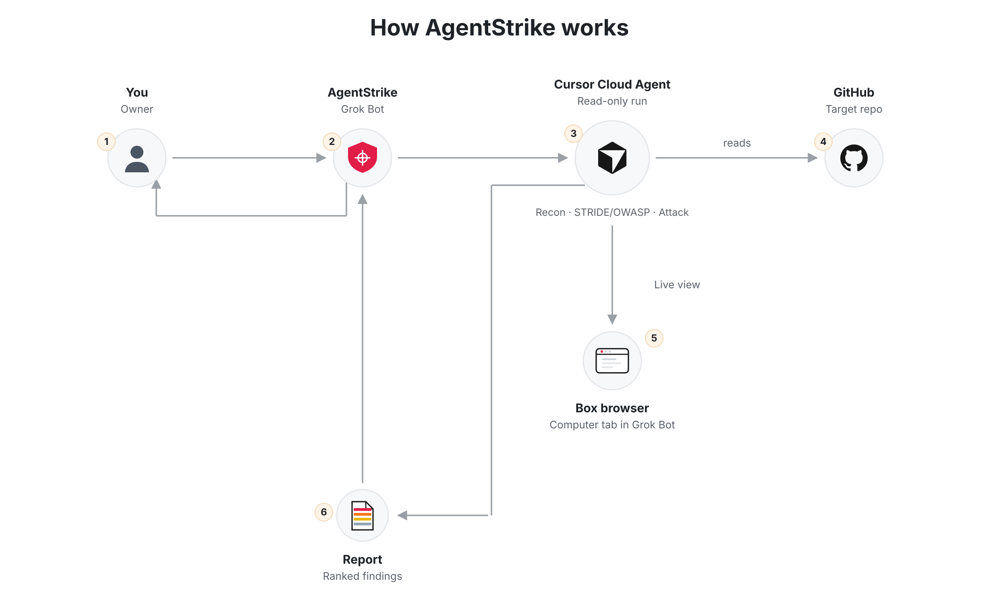

<p align="center">
  
</p>

<h1 align="center">AgentStrike</h1>

<p align="center">Red team your AI agents before attackers do</p>

<p align="center">
  
  
  
  
  <a href="https://x.ai/bot/9sYr4S1elzD7-sCKfr6RO"></a>
</p>

## Overview

AgentStrike is a Grok Bot that red teams AI apps, agents, tool use, MCP, and RAG from their GitHub repos. It scores findings against STRIDE, the OWASP Top 10 for LLM Applications 2025, and OWASP Agentic threats. This repo is the recipe: open the [Bot template link](https://x.ai/bot/9sYr4S1elzD7-sCKfr6RO), or create the bot by hand from [`template/agentstrike-template.json`](template/agentstrike-template.json).

**Guardrails**

- AI and agent apps only. Not general offensive security.
- Phases 0–4 and the retest are read-only: no commits, pull requests, or issues.
- Local only. No live hosts, no real cloud credentials, and no secret values in the report.
- One target at a time. Pass known leads so the run does not re-read the whole tree.
- A fix pull request opens only when you name the findings, and you merge it.

## Key features

- **Scoped to AI apps.** LLM apps, agents, tool use, MCP, and RAG.
- **Phased review.** Inventory, recon, threat model, attack, report, optional fix, retest.
- **Read-only by default.** The review never writes to the repo.
- **Opt-in fix PRs.** `fix C1, H1` opens a pull request per finding, or per severity group, and does not merge.
- **Live view.** The Computer tab shows the cloud agent run and its commands.
- **One report shape.** Summary table, then `ID · title` with severity, OWASP, and STRIDE on their own rows.
- **Shareable template.** Profile, four memories, two skills. No routines or plugins.

## System architecture

<p align="center">
  
</p>

1. **You** name a GitHub owner, or one AI or agent app.
2. **AgentStrike** launches one read-only run with the known leads, then brings the report back to you.
3. **Cursor Cloud Agent** does recon, the threat model, and the attack checks with [`prompts/cloud-agent-redteam-prompt.md`](prompts/cloud-agent-redteam-prompt.md). A fix you ask for uses [`prompts/cloud-agent-fix-prompt.md`](prompts/cloud-agent-fix-prompt.md).
4. **GitHub** is read on the solid arrow, “Reads the code.” The dashed arrow, “Opens a fix PR (only if you ask),” is the only write, and the agent never merges.
5. **Box browser** is the live view. In the Grok Bot app, open AgentStrike's Computer tab. The box browser there shows the cloud agent run page with its live commands.
6. **Report** comes back through AgentStrike. It ends with “Say 'fix C1, H1' to open fix PRs.” Phase 5 retests those ids on the pull request branch.

## Tech stack

| Component | Role |
|-----------|------|
| Grok Bot app | Profile, memories, skills, getting-started skill, and the Computer tab. |
| Cursor cloud agents | One read-only review per target, and an optional fix run that opens pull requests and does not merge. |
| GitHub | Repo inventory, the source the agent reads, and the fix pull requests. |
| Box browser | The desktop browser in AgentStrike's Computer tab. It shows the cloud agent run. |
| STRIDE | Spoofing, tampering, repudiation, information disclosure, denial of service, elevation of privilege. |
| OWASP LLM Top 10 (2025) | LLM01 Prompt Injection, LLM02 Sensitive Information Disclosure, LLM03 Supply Chain, LLM04 Data and Model Poisoning, LLM05 Improper Output Handling, LLM06 Excessive Agency, LLM07 System Prompt Leakage, LLM08 Vector and Embedding Weaknesses, LLM09 Misinformation, LLM10 Unbounded Consumption. |
| OWASP Agentic | Tool misuse, privilege compromise, memory poisoning, excessive agency. |
| Markdown | [`templates/report-template.md`](templates/report-template.md) is the empty report shape. |

## Setup instructions

You need a Grok Bot account, GitHub, and Cursor cloud agents. Nothing to install or clone.

### 1. Get the bot

Open the [AgentStrike Bot template](https://x.ai/bot/9sYr4S1elzD7-sCKfr6RO); the getting-started skill runs on the first chat.

### 2. Connect GitHub

Approve the connection card. Read access is enough for the review. Fix pull requests also need permission to push a branch and open a pull request.

### 3. Cloud agents

They must be available on the same account. AgentStrike launches the run. You do not start the first one yourself.

### Optional: customize or build by hand

Clone only if you want to edit skills or prompts, build the bot manually, or contribute.

```bash
git clone https://github.com/ritvikindupuri/AgentStrike.git
cd AgentStrike
```

Grok Bot shares a Bot template link, not a JSON import. The JSON file is the recipe. To build the bot by hand:

1. Name it **AgentStrike** and paste the profile description from the JSON.
2. Add the four memories: AI-only scope, report format, live view, lean usage.
3. Add [`skills/ai-agent-red-team/SKILL.md`](skills/ai-agent-red-team/SKILL.md) and [`skills/agentstrike-getting-started/SKILL.md`](skills/agentstrike-getting-started/SKILL.md). The second one runs first.
4. Leave routines and plugins empty.

| Path | What it is |
|------|------------|
| `template/agentstrike-template.json` | Profile, memories, skills. No routines or plugins. |
| `skills/ai-agent-red-team/SKILL.md` | Workflow, including the opt-in Fix phase. |
| `skills/agentstrike-getting-started/SKILL.md` | First conversation. |
| `prompts/cloud-agent-redteam-prompt.md` | Read-only review and retest. |
| `prompts/cloud-agent-fix-prompt.md` | Opens fix pull requests. Never merges. |
| `templates/report-template.md` | Empty report. Findings in it are placeholders. |
| `assets/icon.svg`, `assets/icon.png` | Red blob with two white eyes. |
| `assets/architecture.svg`, `assets/architecture.png` | The figure above. |

## Usage guide

Chat with the bot. Watch runs in AgentStrike's Computer tab. Answer one question at a time.

### 1. First conversation

1. GitHub owner. `My GitHub username is octocat. Yes, connect GitHub now.`
2. Where to start. `Inventory my repos and pick the riskiest AI app.` or `Start with octocat/example-agent. It is an MCP agent.`
3. Live view, default yes. `Yes, open each run so I can watch.`
4. Off limits. `Leave octocat/personal-notes alone.`

It saves the owner, the off-limits list, and the live-view choice. Change one later with `Add octocat/archive to the off-limits list.`

### 2. Inventory and pick a target

Inventory flags LLM apps, agents, tool use, MCP, and RAG, ranked by autonomous actions, cloud write access, and tool execution. It skips off-limits repos and stops if none of the repos are AI or agent apps.

`Use the top one.`

One target at a time. Point it at the leads before it starts: `The leads are src/agent/ and src/rag/. Do not read the rest.`

### 3. Watch the run

The review uses [`prompts/cloud-agent-redteam-prompt.md`](prompts/cloud-agent-redteam-prompt.md): recon, threat model, attack, report.

In the Grok Bot app, open AgentStrike's Computer tab. The box browser there shows the cloud agent run page with its live commands. You should see reads, not pushes and not calls to a deployed URL. If it leaves the repo: `Stop. That run tried to leave the repo. Start it again read-only.`

### 4. Read the report

The chat gets the report. For a file: `Write the report to a markdown file in this chat.`

Check the summary table, then each finding. The heading is only the id and title, such as `H1 · A tool argument is taken from model output without an allowlist`. Severity, OWASP LLM Top 10 (2025), OWASP Agentic, STRIDE, and `file:line` are separate rows. Read Impact, Evidence, the payload, and Fix. Reject a finding whose payload is not tied to that location. Keep controls that held. Follow the fix order unless two fixes share lines. A secret finding names a path only. If a value appears: `Redact that. Tell me the path only.`

[`templates/report-template.md`](templates/report-template.md) is the shape. Its findings are placeholders, not results.

### 5. Open fix PRs (optional)

Skip this and edit the code yourself if you prefer. The review that wrote the report stays read-only.

1. Name the findings. `fix C1, H1` opens one pull request each. `fix C1 and H1 in one pull request` groups them.
2. Watch the run in the Computer tab. The prompt is [`prompts/cloud-agent-fix-prompt.md`](prompts/cloud-agent-fix-prompt.md). Expect a new branch, a small diff, and a test or local harness. Expect no merge.
3. Open the pull request on GitHub. The title includes the id, such as `fix(C1): ...`.
4. Review the diff and the body (finding, root cause, change, verification). The old payload should now fail.
5. Retest, then merge it yourself.

### 6. Retest

`Retest C1 and H1 on the fix pull request branch.`

After you merge, point the same request at the default branch. Phase 5 marks each id **fixed** or **open**, with a new `file:line` when it is fixed. It does not start a new hunt.

`Retest every open finding from the last report on the fix pull request branch.`

Next app: `Inventory again and pick the next AI app, skipping anything we already reported.`

### 7. Share the template

`give me your bot template`

Confirm and publish the link. Do not put findings, secrets, or personal data in it.
